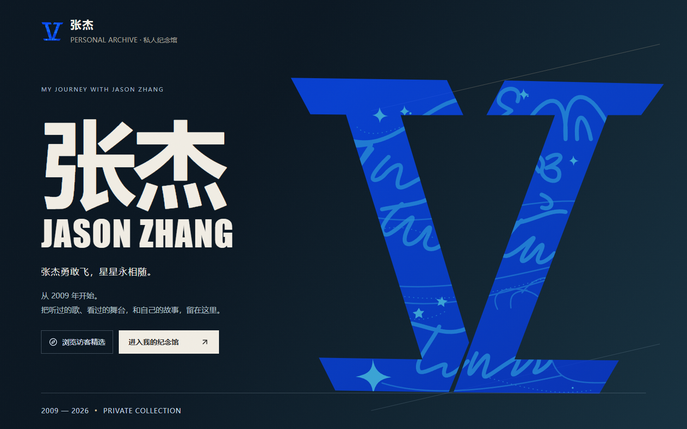
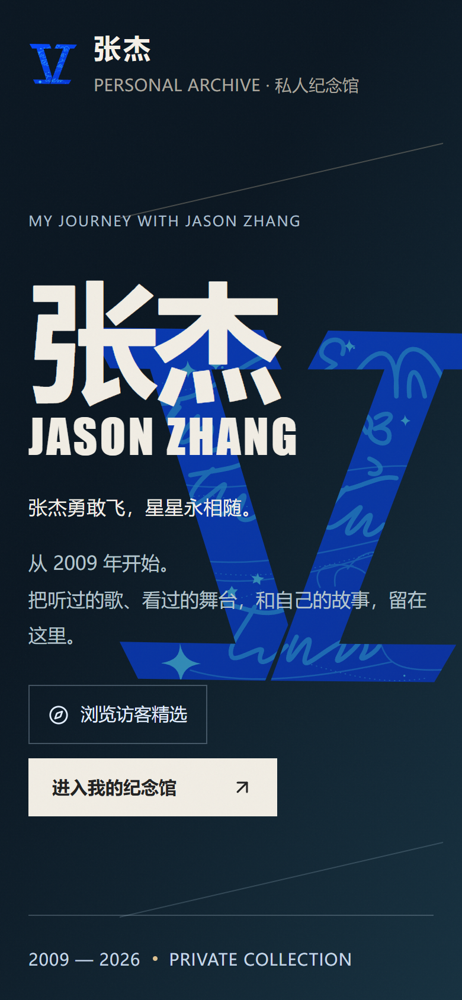
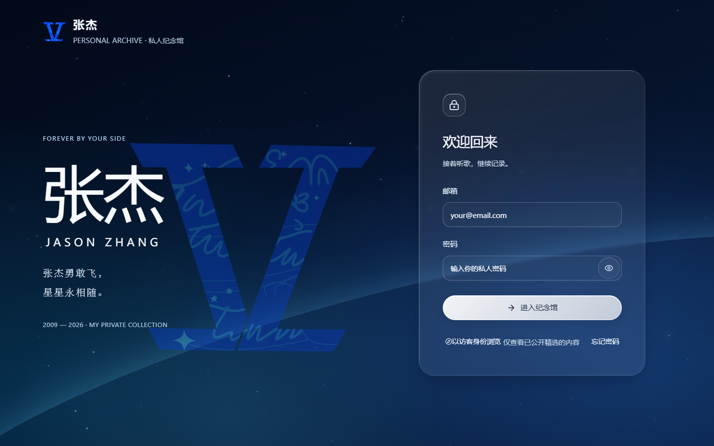
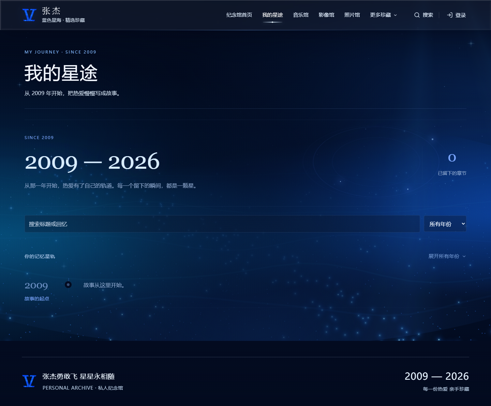
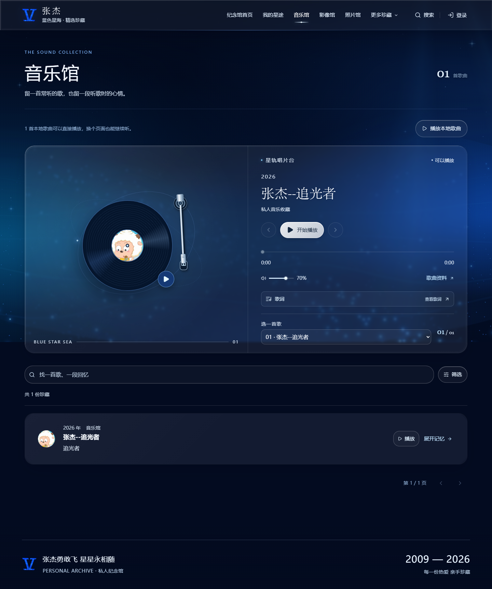
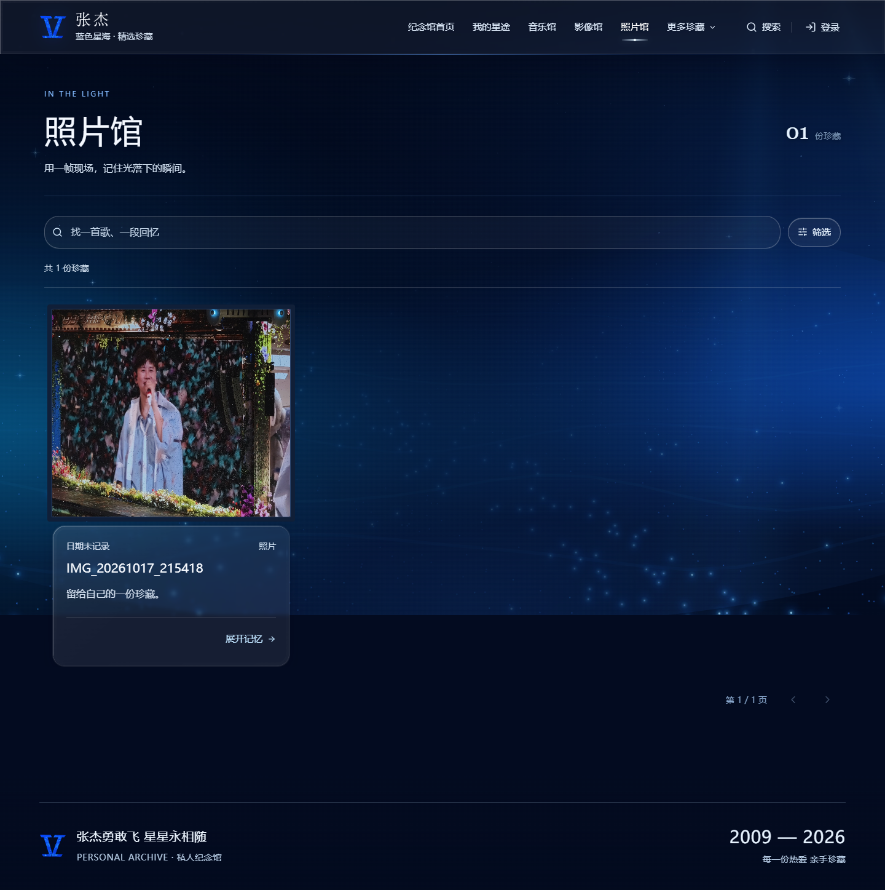
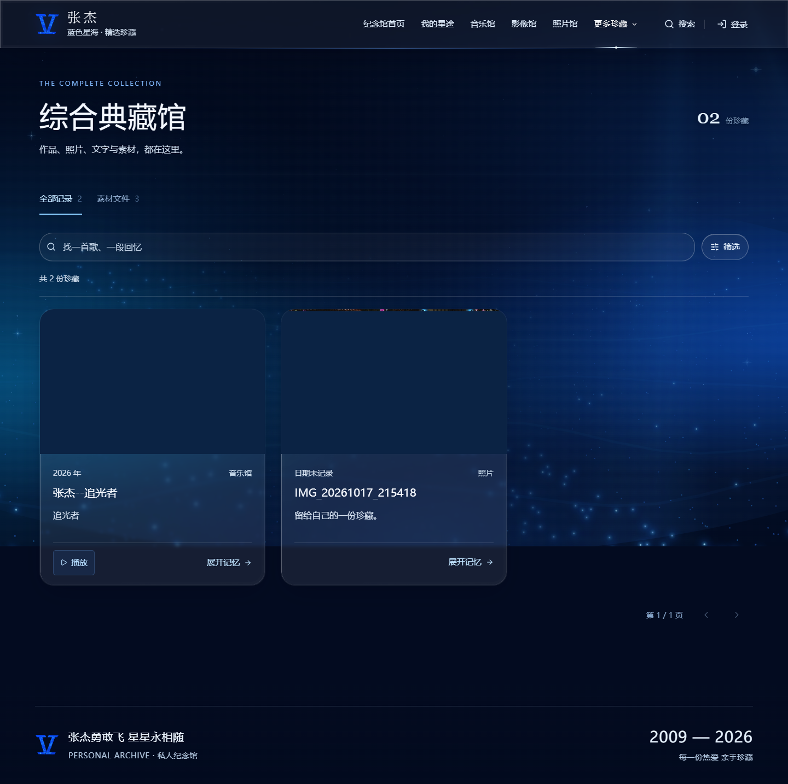
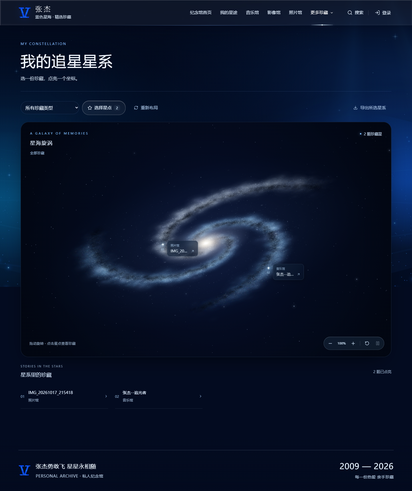
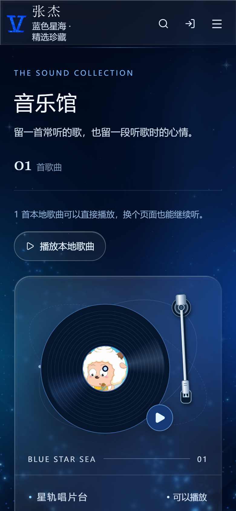
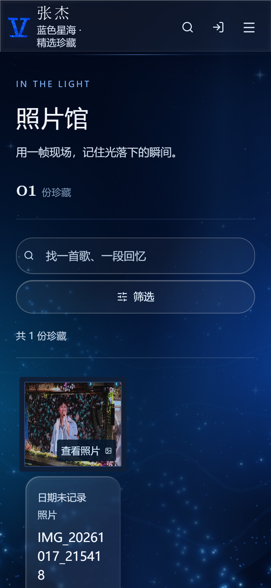

# 十余年星途纪念馆

「张杰勇敢飞，星星永相随。」我喜欢张杰很多年了，所以想用这个网站记录关于张杰的点点滴滴，也留存自己的收藏与回忆。我从 **2009 年**开始喜欢张杰，这一年也是我设定的星途起点；之后可以在私人工作区修改，网站不会据此补写任何经历、作品或演唱会记录。这是我的个人纪念空间，与张杰本人及其团队无关，也不代表他们的立场。新建资料默认只对我开放，我会亲自挑选愿意分享的内容并标记为「公开给访客」；草稿、日记笔记和媒体权利证明始终留在私人空间。

## 项目简介

我把歌曲、专辑、演出影像、照片、时间线和纪念册整理在同一个网站里。平时我登录私人工作区维护完整档案，也会从中挑选部分非草稿内容，开放给来访的人只读浏览。

纪念馆可以在本机使用 SQLite 和媒体文件目录，也可以单独接入 Supabase Auth、PostgreSQL 与私有 Storage。访客只能看到我明确挑选的记录及其关联媒体；日记、权利凭证、账号资料和其他未公开内容都留在我的私人空间。

- **私人工作区**：由我登录后新增、编辑、上传、整理和备份档案。
- **精选分享**：我可以逐条发布或撤回访客可见内容，草稿不会公开。
- **多媒体收藏**：我把歌曲、专辑、照片、视频、演唱会与个人时间线放在一起整理。
- **本地或云端**：本地使用 SQLite；云端可接入 Supabase，媒体存储桶保持私有。
- **响应式浏览**：为桌面和手机提供适配的页面与播放器。

在线访客入口：[打开纪念馆](https://a-decade-of-stars.vercel.app)。

## 界面截图

以下页面以未登录状态打开。截图展示的是我已经挑选公开的内容，不含私人笔记、未公开记录或管理操作。

<table>
  <tr>
    <th align="center">访客首页 · 桌面</th>
    <th align="center">访客首页 · 手机</th>
  </tr>
  <tr>
    <td></td>
    <td></td>
  </tr>
</table>

### 私人工作区登录



### 访客浏览页面

<table>
  <tr>
    <th align="center">我的星途</th>
    <th align="center">音乐馆</th>
  </tr>
  <tr>
    <td></td>
    <td></td>
  </tr>
  <tr>
    <th align="center">照片馆</th>
    <th align="center">综合典藏馆</th>
  </tr>
  <tr>
    <td></td>
    <td></td>
  </tr>
</table>

### 追星星系



### 手机端页面

<table>
  <tr>
    <th align="center">音乐馆</th>
    <th align="center">照片馆</th>
  </tr>
  <tr>
    <td></td>
    <td></td>
  </tr>
</table>

本地模式使用真实 SQLite 数据库和本机媒体目录；云端模式使用 Supabase Auth、PostgreSQL 与私有 Storage。首页配色参考我提供的演唱会海报和“小北斗”拼图，以深海蓝、银灰、暖金为主；这两张图只作设计参考，不会展示在网页上。我另外提供了两张现场照片，并指定蓝色双片衬线 V 作为站点标志和主视觉。私人主题照片只供我自己查看。

## 运行

需要 Node.js **22.13 或更高版本**（本地数据库使用 `node:sqlite`），以及 npm。

```powershell
npm ci
Copy-Item .env.example .env.local
npm run dev
```

打开 **http://127.0.0.1:3000**（本机 3000 端口）。首次打开时，先创建管理邮箱和至少 12 字符的密码；此流程只能直接从 loopback 访问，不能经代理，账号创建后注册入口即关闭。项目没有预置账号或密码。设置了 `APP_ORIGIN` 时，浏览器地址须与配置完全一致；若改用 `localhost`，相应改为 `http://localhost:3000`。未设置 `APP_ORIGIN` 时，本机请求按实际 Host 和监听端口校验，支持直接使用 `127.0.0.1` 或 `localhost`。

Windows 也可运行 `scripts/start.ps1` 或双击 `scripts/start.cmd`。数据默认保存在 `.data/museum.sqlite` 和 `.data/media/`；开发与生产启动共用该目录。请勿删除 `.data`，不要提交它到版本库。修改数据目录时使用 `STARS_DATA_DIR` 绝对路径，并重启应用。

```powershell
npm run typecheck
npm run lint
npm test
npm run test:e2e
npm run build
npm start
```

运行端到端测试时应用使用独立的 3001 端口和 `.test-data/` 目录，不改动私人 `.data`。执行 `npm run build` 后，还可用 `npm run test:local-origin` 验证未配置 `APP_ORIGIN` 的生产启动与浏览器首次创建账号，使用独立的 3002 端口和测试数据库。首次运行浏览器测试可执行 `npx playwright install chromium`；Windows 已安装 Chrome 时配置会自动使用它。详细测试范围与实际执行结果见 [docs/TESTING.md](docs/TESTING.md)。

## 使用

我登录后可以管理歌曲、专辑、视频、照片、年份章节、时间轴、演唱会回忆、信件、日记、纪念日及纪念册。在音乐馆点击「上传歌曲」、影像馆点击「上传演唱会视频」、照片馆点击「添加照片」，选择或拖入本地文件，确认标题并填写权利人与使用依据，即可上传并建立记录。现有歌曲也可直接点「添加音频」，保留原年份、专辑和标签。作品链接与本地文件分别记录，外部素材不会自动下载。

音乐馆的星轨唱片台就是播放器：点击唱片播放或暂停，可在台内切歌、拖动进度及调整音量。点击列表中的歌曲标题、编号或行内空白，会同步上方唱片台；有音频时开始播放，没有音频时显示「添加音频」，保留原有资料。歌曲资料仍可通过详情入口查看。唱片只在实际播放时转动；唱片台、歌曲列表与底部播放器共用同一份选曲和播放状态，通过站内导航切换页面时继续播放。底部播放条闲置 4 秒或浏览页面时自动收成右下角的小图标，歌曲继续播放；点击图标可展开，悬停或键盘操作期间保留控件，也可手动收起或停止关闭。刷新页面不会自动播放。视频使用浏览器播放器，照片支持灯箱与左右切换。音视频文件需要私人保存及 `private_playback` 使用范围；文件仍由服务端校验并通过认证接口读取。

我可以从首页「更换首页照片」进入设置中的主视觉区，分别为桌面与手机选择照片并预览裁剪；清空选择后会回到默认现场照，若我没有设置主照片则显示有许可的替补照片。全站使用蓝色星海，包含持续起伏的灯海、星芒和间歇流星；我可以在设置中关闭动效，页面也会尊重系统的减少动态效果偏好。我上传的照片通过私人媒体 API 展示，不使用共享图片优化器缓存。

星海背景支持私人生成图片关键帧，分镜与实际生成状态见 [背景分镜](docs/starsea-background-prompts.md)。图片就绪后通过认证接口加载，解码成功才参与叠化；未生成或加载失败时继续显示实时灯海。生成使用单独的图像 API，本地运行网站不需要 API 密钥；密钥只在生成时从本机环境变量读取，不写入源码或前端。

首页和登录页提供访客入口。访客无需登录，就能只读浏览我挑选公开且非草稿的记录，以及这些记录直接关联的媒体；未公开记录和草稿不会出现在访客视图中。我可以在编辑记录时通过「公开给访客」开关发布或撤回内容；撤回后，关联媒体也会在下一次请求时停止提供。访客不会获得我的登录状态，新增、编辑、删除、上传、设置和备份仍由我在登录私人工作区后操作。

我可以在设置中调整起始年份、主题、动画、首页顺序与精选内容。备份为我主动下载的 JSON；恢复时先预览再确认，按 ID 合并，不会清空现有数据。**JSON 不含媒体文件本身**，媒体需要另外备份。纪念册只导出我主动选入的记录，打印 PDF 由浏览器完成。

## 架构与云端接入

Next.js App Router、React、TypeScript、Zod、Lucide；本地通过服务端 `node:sqlite` 持久化，云端使用 `@supabase/ssr` 和 `@supabase/supabase-js`。具体版本由 `package-lock.json` 固定。

目录：`app/` 路由和 API，`components/` 工作区与播放器，`lib/server/` 身份与数据操作，`lib/validation/` 校验，`supabase/migrations/` PostgreSQL/RLS/Storage，`tests/` 自动化测试，`docs/` 运维说明。

云端部署要求 Node.js 22.13+（Vercel 可选择 Node.js 24），并设置 `DATA_MODE=supabase`、`NEXT_PUBLIC_SUPABASE_URL`、`NEXT_PUBLIC_SUPABASE_PUBLISHABLE_KEY`、服务端 `SUPABASE_OWNER_ID`、`PUBLIC_MEDIA_READ_TOKEN`、规范 HTTPS `APP_ORIGIN` 和不超过 50 MB 的 `CLOUD_UPLOAD_LIMIT_MB`。`PUBLIC_MEDIA_READ_TOKEN` 是服务端私密值，至少 32 字节随机熵；Supabase 只保存其 SHA-256 摘要。运行应用不需要 `service_role`。按时间顺序应用 `supabase/migrations/` 全部八份迁移；数据库仅允许我配置的管理账号登录，访客精选由受限只读投影提供。访客只能读取我明确公开且非草稿的记录和这些记录直接引用的媒体。新记录默认私人；私密笔记、权利证明、我的账号标识、原文件名与存储路径不会公开。Vercel 不会自动应用数据库迁移，也不会自动搬运本地 SQLite、JSON 备份或媒体文件；详见 [部署](docs/DEPLOYMENT.md)。没有有效 Supabase 凭证时，不把本地或模拟 PostgreSQL 测试称为云端验证。

文档：[数据模型](docs/DATA_MODEL.md) · [安全](docs/SECURITY.md) · [媒体上传](docs/MEDIA_UPLOAD.md) · [素材权利](docs/CONTENT_RIGHTS.md) · [部署](docs/DEPLOYMENT.md) · [备份恢复](docs/BACKUP_RESTORE.md) · [测试](docs/TESTING.md)。

## 许可证

仓库目前没有为源代码指定开源许可证；公开仓库便于查看项目实现，但不代表其他人已获得复制、修改或再发布源代码的授权。仓库内第三方图片等素材各自遵循对应许可，详见 [素材署名](assets/licensed/ATTRIBUTION.md)。
